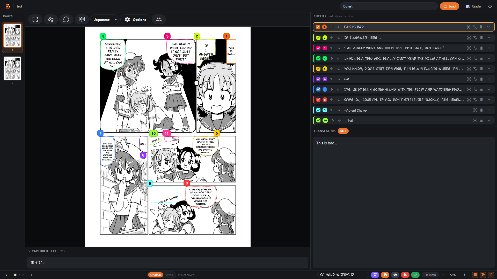
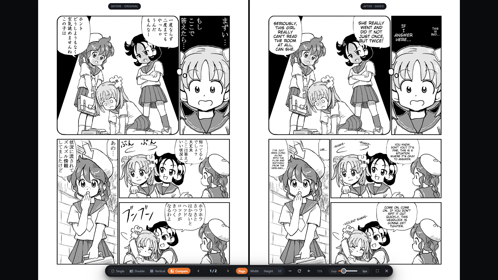

# Fox Reader

Manga translator and reader with OCR, bubble detection, image cleaning, and typesetting.

Open a folder of pages, capture speech bubbles (rectangle, freehand, auto-detect, or whole page), OCR them, translate them, style each entry, then render clean typeset pages to a destination folder — all locally, with optional DeepL / JPDB / custom endpoints.

*This is an early release. Expect bugs, rough edges, and ongoing changes as Fox Reader continues to develop.*



**Before:** the original Japanese page. **After:** the English typeset copy -- side by side in the reader Compare view:



*Manga artwork: "Go Go! Encyclopedia Girls" by Kasuga ([page 3](https://commons.wikimedia.org/wiki/File:Wikipe-tan_manga_page3.jpg)), under [CC BY-SA 3.0](https://creativecommons.org/licenses/by-sa/3.0/). English dialogue above was typeset by Fox Reader; screenshots are shared under the same license.*

## Table of Contents

- [Features](#features)
- [Quick Start](#quick-start)
- [How to Use](#how-to-use)
- [Per-Entry Options Reference](#per-entry-options-reference)
- [Text Clean & Typeset Reference](#text-clean--typeset-reference)
- [Translation Providers](#translation-providers)
- [Custom Endpoints (User Translation APIs)](#custom-endpoints-user-translation-apis)
- [Hotkeys](#hotkeys)
- [Settings & Configuration](#settings--configuration)
- [Environment Variables](#environment-variables)
- [Installation in Depth](#installation-in-depth)
- [Building Executables](#building-executables)
- [Download](#download)
- [Releases](#releases)
- [Development](#development)
- [Project Structure](#project-structure)
- [How It Works](#how-it-works)
- [Troubleshooting](#troubleshooting)
- [Credits & Third-Party](#credits--third-party)

## Features

### Read & navigate

- Image gallery with lazy thumbnails, keyboard navigation, and saved-page badges.
- Work mode (edit) and Reader mode (read) with fit-to-height / fit-to-width, zoom, pan, fullscreen, and webtoon strip mode.
- `Original / Saved` switch per page: compare the source scan against the typeset copy in the destination folder.
- Displayed at `http://127.0.0.1:7954` by default (`config/fox_config.yaml`).

### Capture & OCR

- Four capture flows: rectangle (`c`), freehand (`f`), bubble auto-detect, whole-page capture.
- Bubble auto-detect outline padding: `Bubble pad` slider in Options (0–10 px, default 5).
- Right-to-left reading order by default, switchable to left-to-right, with manual reorder + resort.
- Two OCR engines, switchable in Settings: classic PaddleOCR and PaddleOCR-VL (GGUF vision-language side job).
- Greyscale toggle, Auto-OCR-on-select, click-to-re-read per entry.

### Translate

- Built-in buttons per language: DeepL (`/translate/deepl`, JA/ZH/KO), JPDB (`/translate/jpdb`), local MTL (`/translate/ml`), plus user-defined custom endpoints (`/translate/custom`).
- Local MTL models: Gemma E4B Q6/Q8, Qwen3.5 9B Q6_K/Q8_0 and 4B Q8_0 (JA/KO/ZH), VNTL Llama-3 8B v2 Q5_K_M/Q8_0 (JA-EN), all GGUF via llama.cpp.
- Auto-translate switch, translation context and character/speaker metadata for all local models, custom endpoint editor with preview/test/activate.

### Entries & typesetting

- Entry list = reading order (cards numbered 1..n, same numbers stamped on the overlay).
- Per-entry layer stack 1 (bottom) – 10 (top), gap-free and stable-sorted like the backend composite.
- Backgrounds: `auto` (region dominant colour), `color`, `transparent`, `clean` (repaint artwork via text-clean).
- Fonts served with data URIs + live preview; per-glyph symbol fallback (NotoSansSymbols2) at render time.
- Geometry: word/line spacing (fit-time), X/Y font scale (fit-time), X/Y shift in image pixels + X/Y/Z rotation in degrees (post-fit, text-only — the plate never moves).
- Inline edit-in-place over the bubble (`Enter` commits, `Shift+Enter` newline, `Esc` cancels).

### Text clean & render

- Clean methods: `region` (selected region), `ppocr` (PaddleOCR boxes), `textseg` (glyph UNet++). Reconstruction fills: `hybrid-level`, `hybrid`, `level`, `pyramid`, `telea`, `ns`.
- Detector tuning for TextSeg: speed presets (`best`/`fast`/`fastest`/`single`), tile sizes (`Off`/`256`/`512`/`1024`/`2048` with paired overlap), `glow` / `tta` / `transport` switches.
- Preview renders to `cache/` with progress polling (`/api/progress/{name}`), then Save promotes it (warns `409 exists` / `stale_preview` instead of overwriting blindly).
- Live overlay preview (toggleable) mirrors `src/fox_reader/typeset.py`: same wrap/hyphen rules, same binary-search font fit, explicit per-word spacing, CSS-3D perspective tilt with `cos` fallback.

### Productivity

- Split flow: draw a cut across a region to divide it; pieces inherit styling and slot.
- Characters roster with CSV import/export and speaker attribution for all local models.
- Layouts (`basic` / `vulpes`), dark/light themes.
- Vulpes layout: pages rail + canvas + editor, resizable sections, entry actions in the footer.
- Reader mode (both layouts, in each one's colours): single page, double-page spread (reading-direction aware; cover and landscape pages stand alone), continuous vertical scroll with an adjustable gap, and a before/after comparison of the original against the typeset copy. Centred page-turn arrows, and the whole overlay hides itself once the pointer goes still.
- Session + folder state APIs, single-instance launcher, graceful shutdown (`POST /api/shutdown`).

## Quick Start

### Prerequisites

- Python `>=3.12,<3.13`
- Supported systems: Windows AMD64, Linux x86_64, or Apple Silicon ARM64 with macOS 14 or newer. Intel Macs and Rosetta Python are unsupported.
- [`uv`](https://docs.astral.sh/uv/) installed
- For the UI build: Node.js `22+` and `pnpm` (`pnpm@11`, CI uses Node 24)

### Install & run (source)

Pick the PyTorch backend matching your system. `<backend>` is one of: `cpu`, `macos`, `cu118`, `cu126`, `cu129`, `cu130`, `rocm71`, `rocm72` (ROCm wheels are Linux-only).

```bash
uv sync --extra dev --extra cpu
uv run --extra cpu fox-reader
```

On Apple Silicon, use the `macos` extra so Torch uses its MPS backend:

```bash
uv sync --extra dev --extra macos
uv run --extra macos fox-reader
```

Or with the shortcuts (CPU backend):

```bash
# Windows
run.bat

# Linux / macOS
./run.sh
```

Then open `http://127.0.0.1:7954`. First launch redirects to `/setup`, which downloads the required models (bubble detector, OCR, MTL) from Hugging Face and marks each with a `_completed` file.

Setup refreshes download progress every two seconds while a download is active. Each bar tracks the current file, with a separate file count. Xet downloads show transferred bytes, which can be smaller than the saved file because of compression and caching; files may still need finalizing after transfer reaches 100%. If the transfer size is unknown, setup shows received bytes and an activity indicator.

### GGUF support (local GGUF MTL)

`llama-cpp-python` ships no wheels — every install compiles llama.cpp, and the `CMAKE_ARGS` decide whether the result has a GPU backend. It is therefore installed on its own via `packaging/llamacpp.py`, never through `uv sync --extra gguf`:

```bash
uv run --extra <backend> python packaging/llamacpp.py --device <backend> --install
```

`<backend>` mirrors the torch extras (`cpu`, `cu129`, `rocm72`, `macos`). On CPU it looks for OpenBLAS (offers a download into `nc/`); on CUDA/ROCm it needs the matching toolkit (`nvcc` / ROCm 6.1+). Preview without installing, or install by hand (note `--no-cache-dir` is mandatory — uv's cache key ignores `CMAKE_ARGS`):

On Apple Silicon, `--device macos` builds llama.cpp with Metal and Apple's Accelerate framework using native ARM64 Python and Apple Clang. It targets the M1 CPU baseline and compiles embedded Metal shader source on the destination GPU. Local builds validate a working Metal device by default. GitHub-hosted ARM64 runners can build the same release without exposed GPU hardware: they verify the packaged backends and report GPU execution as untested. See [Apple Silicon build details](docs/llama-cpp-python.md#apple-silicon-portability).

The `auto` device choice uses MPS for Torch OCR, bubble detection and Text Seg, and Metal for GGUF translation and PaddleOCR-VL. On macOS, unsupported Torch operations may fall back to CPU; bubble suppression runs on CPU because torchvision has no MPS NMS kernel. Explicit CPU selection remains available in settings.

```bash
python packaging/llamacpp.py --device cu129 --print-args
CMAKE_ARGS="<printed line>" uv pip install --no-cache-dir llama-cpp-python
```

Windows notes: hand installs need `CMAKE_GENERATOR` too (`MinGW Makefiles` + MinGW compilers, or Ninja inside a VS Developer Prompt for MSVC). MinGW builds also need `-D_WIN32_WINNT=0x0A00` (printed as `CFLAGS`/`CXXFLAGS`) and copy `libgcc`/`libstdc++`/`libwinpthread` DLLs next to the built lib — `--install` handles all of this automatically.

Useful flags: `--openblas {auto,download,off}`, `--cpu-baseline {avx2,avx,sse42}`, `--cuda-arch` / `--hip-arch`, `--python PATH`, `--find-openblas`.

## How to Use

1. **Load a folder.** Type a source folder path (or pick it in the folder modal) and optionally a destination folder. Loading sets the gallery, page dimensions, and which pages already have a typeset copy (`saved` badges). When source and destination are the same folder, saving overwrites and the `Original / Saved` switch hides.
2. **Pick a page.** Click a gallery thumbnail or use `ArrowRight` / `ArrowLeft` (`h` toggles the gallery). The viewer fits the page; zoom with `+` / `-` / `0`, pan by dragging.
3. **Capture regions.** Press `c` (rectangle), `f` (freehand), the bubble button (bubble auto-detect), or page capture (whole-page OCR+translate). Drag on the page; `Esc` cancels. Each capture becomes an entry card (reading order = list order).
4. **OCR.** Click an entry (or its OCR button) to read the region into the editor. `Auto OCR` reads entries with no text on select; greyscale and language (`languageSelect`: japanese/chinese/korean) apply.
5. **Translate.** With `Auto TL` on, translation follows OCR automatically. Otherwise click the entry's Translate button (DeepL / JPDB / MTL / custom, per language). Results land in the translation panel (`#translatedText`).
6. **Confirm.** `Confirm Entry` stores editor + panel text onto the captured region. Re-confirming the same region replaces text but keeps styling.
7. **Style entries.** Expand an entry (`expand_more`) for fonts, colours, layer, alignment, speaker, background, clean settings, spacing/scale/shift/rotate (see reference below). Every control repaints the overlay immediately (`refresh`); structural clean changes rebuild the panel (`rebuild`).
8. **Preview & save.** `Preview` renders the current page to `cache/` in a modal (progress polled); `Save` writes it to the destination folder (`Save` in the modal commits the preview token). `Generate` renders straight to the destination. Existing files need overwrite consent (`409`).
9. **Compare.** Flip `Original / Saved` on pages with a saved copy. Editing locks while viewing Saved (entries describe the original).

Tips: right-click a card or region to hide it from the render; layers decide paint order (10 on top); empty text + `clean`/colour background erases a bubble; `transparent` draws text with no plate.

## Per-Entry Options Reference

| Group | Controls | Values |
|---|---|---|
| Layer / Align / Speaker | Layer stepper, alignment segmented, speaker select | Layer `1–10` (ceiling = highest other + 1); align `center/right/left`; speaker `None` + character roster (`meta_id`) |
| Font / Outline | Family select, size select, font colour; outline width + colour | Size `Auto` + `6–72`; outline `Auto` + `0–32` (auto ≈ `round(size×0.09)`, min 1); colours `Auto` (detected) or hex |
| Spacing / Scale | `W` word spacing, `L` line spacing, `X`/`Y` stretch | `W` `Auto` + `0.0–3.0×`, `L` `Auto` + `0.5–3.0×` (tenths); scale `0.5–2.0×` (neutral `1.0`, part of the font fit) |
| Shift / Rotate | `X`/`Y` nudge (image px), `X`/`Y`/`Z` rotation (deg) | Shift bounded by page when loaded, backend clamps to ink; angles `−180–180` (X/Y tilt plane, Z spins clockwise, all about block centre, text-only) |
| BG | Mode select + colour | `auto` / `color` (+hex) / `transparent` / `clean` |
| Clean (when `BG=clean`) | Method + fill + tweaks | Method `region`/`ppocr`/`textseg`; fill `hybrid-level/hybrid/level/pyramid/telea/ns`; speed `best/fast/fastest/single`; tile `Off/256/512/1024/2048`; `glow`/`tta`/`transport` per method knobs |

Defaults for untouched entries reproduce the pre-geometry render exactly (`word=None, line=None, scale=1, shift=0, angle=0`).

## Text Clean & Typeset Reference

- **What runs:** clean-mode entries repaint artwork first (detection shared across frames), then entries composite bottom-layer-first (`typeset._ordered`), each with its plate + fitted text + post-fit transforms.
- **Typeset fit:** largest `6–72` px that fits the padded type area (12% horizontal / 10% vertical padding), binary-searched then verified; spacing + scale participate in the fit, shift/rotation apply afterwards to the lettering only.

### Detection — Method (where the lettering is)

One detection pass runs per page, not per entry: entries sharing a detector (and, for TextSeg, the same tuning) share one result over the union of their regions. Animated pages detect once and reuse it across frames.

| Method | What it removes | Cost | Knobs |
|---|---|---|---|
| `region` (default) | Your selection verbatim — everything inside the shape, no model, cannot miss | Instant | None (`fill` + `transport` still apply) |
| `ppocr` | PP-OCRv6 detector quads, one per text line (~2 s/page, model already loaded) | Fast | None — box coverage has no halo for Glow to absorb (`fill` + `transport` still apply) |
| `textseg` | Glyph-level UNet++ segmentation + stroke-radius-relative mask refinement (counters filled, specks dropped, glow absorbed) | Slowest, most precise (20–40 s/page on CPU; runs on the padded union crop, not the full page) | `glow`, `speed`, `tta`, `tile` |

Preview marking: `region` = blurred plate, `ppocr` = diagonal hatch, `textseg` = dots. Unknown method names from stale projects fall back to `region` rather than failing the page.

### Reconstruction — Fill (how the pixels underneath are rebuilt)

Each text cluster is rebuilt inside its own neighbourhood (local crop, grown until ≥45% known pixels), largest first, so nearby paint — not distant art — is the source. Flat-paper holes are pre-filled with the ring median (avoids grey ghosts on white bubbles). Ordered best-first in `INPAINT_METHODS`; the default is the first non-`transport` entry because `transport` costs seconds per cluster. What the panel offers depends on the OpenCV build (`caps` probes `xphoto.inpaint` + flag, since OpenCV 5 ships an empty `xphoto` module that imports but cannot run): pure-xphoto fills hide when unavailable (degrading would leave Telea wearing their name), while hybrids degrade their detail term to Telea and keep their pyramid shading intact. Unknown fills fall back to the default.

| Fill | How it works | Best for / watch out |
|---|---|---|
| `hybrid-level` (default) | Pyramid shading + FSR high-frequency detail, level-fixed | Painted artwork; ~1 s/cluster trade that holds up |
| `hybrid` | Pyramid shading + transported edge detail (Telea when xphoto missing) | Soft art needing edge continuation |
| `hybrid-fsr` | Pyramid shading + FSR detail variant | Line art / hatching over shading |
| `hybrid-patch` | Pyramid shading + patch-synthesis detail (real paint texture) | Textured paint where grain matters |
| `level` | Pyramid solver with boundary-implied re-levelling | Smooth gradients with tone steps |
| `pyramid` | Push-pull interpolation + matched grain (no invention) | Soft airbrushed fills; hazes on very wide holes |
| `patch` | Multiscale patch synthesis | Real texture; can mismatch shading / ridge on wide holes |
| `transport` | Offset (shiftmap) cover with whole displaced pieces + tone fix | Structure at every scale (hair, folds); can invent content; ~20 s |
| `fsr` / `fsr-fast` | Frequency-selective reconstruction (BEST / FAST) | Straight edges continuing as themselves; hidden without xphoto flags |
| `shiftmap` | xphoto shiftmap in Lab | Offset fill; hidden without its flag |
| `telea` / `ns` | OpenCV diffusion inpaint (radius 7) | Always available; Telea is the universal fallback |

### Parameters (entry clean panel)

| Parameter | Applies to | Meaning |
|---|---|---|
| `method` | All | Detection source above (`region`/`ppocr`/`textseg`) |
| `fill` | All | Reconstruction above (`hybrid-level` default) |
| `glow` (default on) | `textseg` only | Absorb the feathered glow around text into the mask (`glow_k 2.0` vs `0.0` = CLI `--no-glow`); distances in stroke radii so cover titles and furigana behave |
| `transport` (default on) | All fills | Allow escalation: wide holes (`half-width ≥ 60 px`) in textured paint (median high-freq `≥ 2.0` in the 2–10 px shell) escalate smear-prone fills to offset `transport`; wide holes in flat paint correctly stay smooth. Needs xphoto `transport` or escalation stays off. Reconstruction groups by `(fill, transport)` |
| `speed` (default `fastest`) | `textseg` only | `best`: flips + scales `(1.0, 0.6, 0.4)` + inverted pass (≤24 passes) · `fast`: no flips (≤6) · `fastest`: no inverted pass either (≤3; within 6.2% of `best` for ⅛ the cost — the interactive default) · `single`: one scale (1 pass, cheapest, no cross-scale vote to filter artwork). Inverted pass auto-skips on pages with no dark ground. Stale names → `fastest` |
| `tta` (default on) | `textseg` only | Flip test-time averaging (4 views). Only `best` ships flips, so only there does off save 4×; elsewhere the switch is stored but inert (dimmed, still clickable) |
| `tile` (default `Off`) | `textseg` only | `Off` (whole image, only whole-page view) / `256+48` / `512+96` / `1024/2048+192` overlap, cosine-blended. Small tiles exist for machines that cannot hold page activations, not for better detection. Only tabulated sizes accepted |

Switching method never loses tuning: `speed`/`tta`/`tile` ride along so toggling back restores them.

## Translation Providers

| Provider | Endpoint | Notes |
|---|---|---|
| DeepL | `POST /translate/deepl` | Needs API token in Settings; buttons hidden until `/api/translate/status` allows; `:fx` keys use the free host |
| JPDB | `POST /translate/jpdb` | Japanese parser API, token in Settings |
| Local MTL | `POST /translate/ml` | Gemma E4B Q6/Q8 and Qwen3.5 9B Q6_K/Q8_0, 4B Q8_0 (JA/KO/ZH); VNTL Llama-3 8B v2 Q5_K_M/Q8_0 (JA-EN). All support context + characters. Load/unload + memory check via `/ml/*` |
| Custom | `POST /translate/custom` | User-templated endpoints (editor at `/user_endpoints`, preview/test/activate per language) |

Context pairs and character links ride only on MTL/custom requests, gated by the Context/Characters switches.

### Local translation models

Choose and download models from `/setup`, accepting each model's terms before
its download. Select the model per source language in `/settings`. All translate
into English; Japanese, Chinese and Korean are abbreviated JA, ZH and KO below.

| Model | Quantisation | Source languages | Download size | Upstream terms |
|---|---|---|---|---|
| [Gemma 4 E4B Uncensored (Aggressive)](https://huggingface.co/HauhauCS/Gemma-4-E4B-Uncensored-HauhauCS-Aggressive) | Q8_K_P | JA/ZH/KO | 7.6 GiB | Gemma Terms of Use |
| Gemma 4 E4B Uncensored (Aggressive) | Q6_K_P | JA/ZH/KO | 5.8 GiB | Gemma Terms of Use |
| [VNTL Llama3 8B v2](https://huggingface.co/lmg-anon/vntl-llama3-8b-v2-gguf) | Q8_0 | JA | 8.0 GiB | Llama 3 Community License |
| VNTL Llama3 8B v2 | Q5_K_M | JA | 5.3 GiB | Llama 3 Community License |
| [Qwen3.5 9B Uncensored (Aggressive)](https://huggingface.co/HauhauCS/Qwen3.5-9B-Uncensored-HauhauCS-Aggressive) | Q6_K | JA/ZH/KO | 6.9 GiB | Apache 2.0 |
| Qwen3.5 9B Uncensored (Aggressive) | Q8_0 | JA/ZH/KO | 8.9 GiB | Apache 2.0 |
| [Qwen3.5 4B Uncensored (Aggressive)](https://huggingface.co/HauhauCS/Qwen3.5-4B-Uncensored-HauhauCS-Aggressive) | Q8_0 | JA/ZH/KO | 4.2 GiB | Apache 2.0 |

Gemma and Qwen receive earlier translations, character names, aliases, gender
and speaker attribution through the translation prompt. Both VNTL quants use
the model's trained metadata and dialogue format. The additional fields are
optional: requests containing only the new text work for every model, including
when there is no earlier context. Enable **Characters** and assign a speaker to
an entry to identify who is speaking; the roster can also guide names mentioned
in dialogue.

When prompts are full, Gemma and Qwen discard unused roster entries before
older context, while keeping the current speaker. This trims only the request;
the roster itself is unchanged. The CSV/API fields `name_ja` and `alias_ja`
retain their existing names and hold the original-language name and alias for
Chinese and Korean too; the roster editor labels them **Name (original)** and
**Alias (original)**.

Qwen runs in non-thinking mode for direct text translation. Fox Reader downloads
only the selected text GGUF; no vision encoder (`mmproj`) is needed. Each model's
**Context Window** in `/settings` defaults to **8192** tokens. Gemma and Qwen
also offer **16384**; both VNTL quants stay at their trained **8192** limit.
Changes take effect the next time that model is loaded. The selected size must
fit the actual GGUF's declared limit. The 16384 option adds an estimated
384 MiB of RAM/VRAM for cache and working buffers; model weights keep the same size.
The window includes the prompt and reply; translation drops older context when
space is needed and reserves up to 1024 tokens for the reply.
RAM/VRAM requirements shown as **estimates** for the new
VNTL Q5 and Qwen variants include runtime overhead and are not benchmarked peaks;
actual usage varies with the backend and text. Download size is not a memory
requirement. See the [GGUF backend guide](docs/llama-cpp-python.md) for builds and
device support.

## Custom Endpoints (User Translation APIs)

Connect an HTTP translation service through **Settings > Manage endpoints**, or open `/user_endpoints`. Define its connection, request schema, response schema, and optional authentication/encryption, then save, test, and activate it for a reader language. Each language supports up to 20 saved endpoints and 3 active translator buttons.

See the **[Custom endpoints guide](docs/custom-endpoints.md)** for the complete field reference, setup steps, request/response examples, context and character support, current-speaker IDs, saved-key Show/Hide, key rotation, troubleshooting, and management API.

Context and character data are sent through the schema nodes you configure. **Current Speaker** sends the new text's `meta_id`; **Context Links** identifies speakers of earlier pairs. **Preview request** builds a draft without contacting the service; **Send test** sends a real request with sample data and displays the actual request used. Saved encryption keys can be revealed explicitly with **Show** when reopening the editor.

Use **Export YAML** to copy one endpoint from its overlay, or **Import YAML** to paste and validate an editable draft before saving. Shared encryption keys are excluded; enter your own key for an encrypted import. Check headers, query values, and static fields for other credentials before sharing. Enter the hostname/path without `http://` or `https://` and choose the protocol using **Scheme**.

Configurations and language activation persist in `config/user_endpoints.yaml`.

## Hotkeys

Typing in inputs/textareas (or the editable translation panel) disables editing hotkeys. Loading overlay, backend-status overlay, and folder modal also suppress them. `F11` or `Alt+Enter` toggles fullscreen throughout the app, including the desktop loading window. On Mac keyboards, `F11` may require `Fn` if macOS reserves the key.

**Work mode** (default):

| Key | Action |
|---|---|
| `c` | Rectangle capture |
| `f` | Freehand capture |
| `h` | Toggle gallery panel (re-fits viewer) |
| `ArrowRight` / `ArrowLeft` | Next / previous page |

**Reader mode** (`workspace-reader`):

| Key | Action |
|---|---|
| `ArrowRight` / `ArrowDown` / `Space` | Next page |
| `ArrowLeft` / `ArrowUp` | Previous page |
| `f` | Fullscreen toggle |
| `s` | Strip (webtoon) mode toggle |
| `+` / `=` , `-`, `0` | Zoom in / out / refit |
| `Esc` | Back to work mode |

**Editors & dialogs:**

| Context | Key | Action |
|---|---|---|
| Inline bubble editor | `Enter` / `Shift+Enter` / `Esc` | Commit / newline / cancel |
| Colour hex box | `Enter` | Commit parsed hex |
| Eyedropper / capture stroke | `Esc` / right-click | Cancel pick / cancel stroke |
| Preview modal, character/appearance modals | `Esc` | Close |
| Folder path input | `Enter` | Load folder |

## Settings & Configuration

On-disk state lives in the source checkout's root or beside the packaged launcher. Configuration files are local user data and are gitignored; builds do not include `fox_config.yaml`.

- `config/fox_config.yaml` — created with built-in defaults on first launch: `host: 127.0.0.1`, `port: 7954`, `mtl_dir: models`, `theme: dark`, `layout: basic`. Fox Reader creates `config/` when needed. `host`/`port` require a restart.
- `config/user_config.yaml` — optional configuration you create manually; takes precedence over `fox_config.yaml`.
- `config/settings.yaml` — `mtl_defaults` per language (`japanese/korean/chinese`), `devices` (`paddleocr/paddleocr_vl/bubble/translator/textseg: auto|<device>`, `mtl_threads`), `deepl_api_token` / `jpdb_api_token`, `ocr_engine: paddleocr|paddleocr-vl`.
- `config/user_endpoints.yaml` — custom translation endpoints.
- `config/workspaces.yaml` — panel layout sizes.
- `models/` — weights (bubble `model.safetensors`, PaddleOCR det/rec + VL GGUF, manga seg safetensors, MTL Gemma/VNTL/Qwen). Downloaded once via `/setup`; each completed download touches a `_completed` marker.
- `fonts/` — your `.ttf`/`.otf` faces (scanned + cached in `.fonts_cache.json`); ComicMono and NotoSansSymbols2 are bundled. `NotoSansSymbols2` is a render-time per-glyph fallback, never listed. Guide (adding faces, symbol fallbacks, licensing): [`/FONT.md`](/FONT.md).
- `cache/` — scratch previews/masks; cleared at startup and shutdown.

Each launch checks the configuration, fills in newly added fields, and repairs invalid fields while preserving valid settings and unknown fields when the YAML parses. Repairs update the file directly without automatic backups; malformed documents are replaced with defaults. See [Configuration](docs/configuration.md) for accepted values, file precedence, repair behavior, and diagnostics.

Pages:

- `/setup` — first-run wizard: required + MTL download state, per-file progress, optional OCR-VL side job, finish/close.
- `/settings` — devices (per-slot AUTO + thread count), per-language MTL defaults, API tokens (validated), OCR engine switch.
- `/user_endpoints` — custom endpoint CRUD, mustache-style preview, test call, per-language activation.
- Characters modal — speaker roster CRUD + CSV import/export for all local models; entry Speaker select tags `character_id`.

## Environment Variables

| Variable | Default | Effect |
|---|---|---|
| `FOX_READER_LOG_LEVEL` | `INFO` | Log verbosity |
| `FOX_IMAGE_RENDER_QUALITY` | `1` | Image improvements: `1` native app windows on every OS, `2` native windows and browsers, `3` existing rendering. Invalid values disable the improvements. Set before starting the backend. |
| `FOX_READER_ROOT` | exe dir / source root | Override project root (models/fonts/config resolution) |
| `FOX_READER_DISK_ASSETS` | off | Read embedded frontend/fonts from disk (dev) |
| `FOX_READER_MTL_THREADS` | settings heuristic | Override MTL thread count |
| `FOX_READER_IGNORE_MTL_MEMORY` | off | Skip the VRAM gate before loading local MTL |
| `FOX_READER_MTL_VERBOSE` | off | Verbose local-MTL (llama.cpp) logging |
| `FOX_READER_VL_VERBOSE` | off | Verbose PaddleOCR-VL logging |
| `FOX_READER_SHUTDOWN_TOKEN` | open | Gate `POST /api/shutdown` (launcher sets it) |

`USERNAME`/`USER` fall back to `fox-reader` for endpoint rendering.

## Installation in Depth

| Backend extra | Torch index | Platform |
|---|---|---|
| `cpu` | CPU | Windows AMD64 / Linux x86_64 |
| `macos` | PyPI | Apple Silicon ARM64, macOS 14+ |
| `cu118` / `cu126` / `cu129` / `cu130` | matching CUDA index | Windows AMD64 / Linux x86_64 (CUDA toolkit needed for GGUF builds) |
| `rocm71` / `rocm72` | ROCm index | Linux only (no ROCm wheels on Windows/macOS) |

`cu129` is the CUDA 12.9 extra on both Windows and Linux. Platform markers select the compatible versions from the same CUDA 12.9 index: the lock contains Torch 2.8.0 / torchvision 0.23.0 on Windows and Torch 2.13.0 / torchvision 0.28.0 on Linux. Replace the former `--extra cu129_win` with `--extra cu129` in install commands, and `--device cu129_win` with `--device cu129` in build commands. Windows archives now use `cu129` in their names too.

```bash
uv sync --extra dev --extra <backend>
uv run --extra <backend> fox-reader
```

Frontend (TypeScript + Vite + Preact):

```bash
cd frontend
pnpm install
pnpm dev      # watch mode (Terminal 1) + `uv run fox-reader` (Terminal 2)
pnpm build    # → static/app.js (gitignored IIFE bundle)
```

Windows `pnpm install` may fail with `UNKNOWN ... symlink`: enable Developer Mode (Settings → System → For developers) or `pnpm install --node-linker=hoisted`. `packaging/build.py` retries with that flag automatically.

## Building Executables

> New to this? Start with [`packaging/build.md`](packaging/build.md) — the
> copy-paste guide (what to download, which `--device` for your GPU, build,
> run) for Windows, Linux, and Apple Silicon macOS.

Standalone builds compile the backend with [Nuitka](https://nuitka.net/), embed the frontend, and ship a small native launcher. The launcher shows a loading banner immediately, then opens the reader in the system WebView after the backend is ready. FastAPI still serves the same Preact frontend over localhost; OCR and translation remain in the detached backend process.

Result layout:

```
fox-reader/
  launcher(.exe)   desktop window and backend lifecycle
  foxreader-updater(.exe)  separate update window (native-window builds)
  Fox Reader.app/  Finder entry point (macOS only)
  libfox-window.so WebKitGTK viewer (Linux only)
  libfox-browser.so GTK-only browser controller (Linux only)
  bin/             compiled backend + linked libs (+ MSVC runtime DLLs + .dist-info metadata)
  cache/           scratch (empty, created at build)
  config/          created on first launch, including fox_config.yaml
  fonts/           your fonts
  models/          weights (downloaded on first run)
  legal/           licences, notices, terms, and font guide
  icons/           desktop icons
  logs/            launcher, backend, and frontend diagnostics
  build-info.json  installed version and CPU/CUDA/GGUF variant
```

Windows uses the installed [WebView2 Evergreen Runtime](https://developer.microsoft.com/microsoft-edge/webview2/); if it is missing, the launcher opens your browser and offers Microsoft's runtime installer link. Linux uses the distribution's WebKitGTK (`sudo apt install libwebkit2gtk-4.1-0` on Ubuntu/Debian). Without WebKitGTK, Linux opens the browser and keeps a separate GTK-only controller visible. macOS uses built-in WKWebView. No Chromium runtime is bundled.

Packaged legal documents live in `legal/` beside the launcher: `LICENSE`, `NOTICE`, `TERMS.md`, `FONT.md`, `OFL.txt`, `LICENSE-ComicMono`, and `LICENSE-material-icons`. Native Windows builds also include `WebView2-LICENSE.txt` there; builds with Vite's generated licence report include `frontend-licenses.md`. Source files remain in their existing repository locations.

Double-click `launcher.exe` on Windows or `Fox Reader.app` on macOS. On Linux, put the extracted folder in its final location, run `./install-desktop.sh`, then open **Fox Reader** from your applications menu; the entry uses `Terminal=false`. Keep the whole portable folder together, including `config`, `fonts`, and `models` beside the Mac app.

`launcher --browser` opens the system browser and keeps a controller window available. `launcher --cli` (or `FOX_READER_CLI=1`) runs the backend with a foreground terminal manager, without opening a browser or window; Ctrl+C stops the backend it started. Closing the desktop controller also stops its owned backend, with a 20-second graceful shutdown period. A controller attached to an already-running backend leaves that backend running.

The Linux browser controller shows the running state and provides **Open Reader** and **Quit Fox Reader**. Closing the browser leaves this controller visible. If GTK cannot open a window, the launcher uses an attached terminal or opens a terminal manager before starting the backend. If neither is available, it reports the failure without starting an invisible backend. Diagnostics are in `logs/launcher.log`, `logs/backend.log`, `logs/backend-output.log`, and `logs/frontend.log`.

In packaged builds, **Settings → Updates → Download and install** verifies the release, opens the separate updater, and closes Fox Reader. Save your work before starting. The updater replaces `bin/`, `legal/`, and `build-info.json`, merges fonts, refreshes the launcher and managed assets, and preserves `config/` and `models/`. Failed replacements roll back; interrupted transactions recover through the next launcher. Success does not restart the app: close the updater and launch Fox Reader yourself. Packaged installations without the helper retain manual verified downloads. Source runs have no update controls or update API access. See [Updating Fox Reader](docs/updating.md) and [desktop testing notes](docs/desktop.md).

For a build without any Fox Reader graphical windows, use `python packaging/build.py --no-window`. It opens the system browser and keeps a terminal manager visible; Ctrl+C stops the backend it started. `launcher --cli` (or `FOX_READER_CLI=1`) skips the browser for terminal/headless use. There are no native reader, loading, controller, or error windows in this variant. On Windows open `launcher.exe`; on Linux install its menu entry with `./install-desktop.sh` (it uses `Terminal=true`); on macOS open `Fox Reader.command` in Terminal. Keep the terminal open while reading: closing the browser alone does not stop the backend. A second manager attached to an existing backend only detaches when stopped.

This optional local build omits WebView2, the Linux GTK/WebKitGTK plugins, and the graphical updater, and does not create a Mac `.app`. Its archive has a `-no-window` suffix and `build-info.json` records the variant. The regular CI builds remain native-window builds; updating this custom variant requires another `--no-window` build.

### Prerequisites

- `uv`, `pnpm`, Node.js `22+` (CI pins 24 + pnpm 11), Python `3.12`
- Native compiler for the launcher and C++17 updater (verified by compiling+linking a smoke program; `python packaging/toolchain.py --which` shows the winner):
  - Windows: VS Build Tools with “Desktop development with C++” and the Windows SDK are required for the WebView2 host. Native-window builds download a pinned, SHA512-verified WebView2 SDK header and static loader; they do not download a browser runtime. For an offline native-window build, set `FOX_WEBVIEW2_SDK` to the unpacked Microsoft.Web.WebView2 `1.0.2903.40` NuGet package. MinGW can also compile the `--no-window` launcher and standalone C test fixtures; CUDA builds retain their own compiler requirements.
  - Linux: `gcc`/`clang`, `pkg-config`, and WebKitGTK headers (`sudo apt install build-essential pkg-config libwebkit2gtk-4.1-dev`); CUDA variants pin GCC per toolkit (11.8→11, 12.6/12.9→13, 13.0→14).
  - macOS: native ARM64 Python 3.12 and Apple Clang from Xcode Command Line Tools (`xcode-select --install`), macOS 14+. Local verification requires a working GPU by default; [GitHub-hosted builds](packaging/build.md#build-macos-releases-on-github) handle runners without GPU access.
- GPU builds: matching CUDA toolkit (`nvcc`) or ROCm 6.1+; CPU GGUF builds want OpenBLAS (`apt install libopenblas-dev` on Linux, or `--openblas download`).

### Build commands

```bash
python packaging/build.py
python packaging/build.py --clean            # wipe previous artifacts first
python packaging/build.py --skip-frontend    # reuse prebuilt static/app.js
python packaging/build.py --no-window       # browser + terminal, no Fox Reader GUI
python packaging/build.py --keep-venv        # reuse build venv next time
python packaging/build.py --deep-compile     # compile deps too (hours)
python packaging/build.py --device cpu       # cpu|macos|cu118|cu126|cu129|cu130|rocm71|rocm72
python packaging/build.py --device macos     # Apple Silicon: Torch MPS + llama.cpp Metal
python packaging/build.py --nuitka-arg ARG   # repeatable, forwarded to Nuitka
python packaging/build.py --no-blas          # alias for --openblas off
```

GGUF / CPU tuning:

```bash
python packaging/build.py --no-gguf
python packaging/build.py --gguf-device cpu          # CUDA torch + CPU llama.cpp
python packaging/build.py --openblas download
python packaging/build.py --cpu-baseline sse42       # avx2 (default) | avx | sse42
python packaging/build.py --cuda-arch 75-real,86-real,120-virtual
python packaging/build.py --hip-arch gfx1100,gfx1201
```

Defaults compile only `fox_reader` + entry (5–15 min); `--deep-compile` is the slow release path. Nothing targets the build machine specifically (`GGML_NATIVE=OFF`, pinned ISA, virtual GPU arches for CUDA JIT fallback and embedded Metal shader source on macOS). Archives are named `fox-reader-v{version}-{device}[-gguf[-ggufDevice]]-{platform}` (zip on Windows, tar.gz on Linux/macOS).

macOS defaults to `--device macos`; Windows/Linux default to `cpu`. The Mac archive ends in `macos-arm64.tar.gz` and targets all Apple Silicon generations running macOS 14+, subject to available memory and model requirements. `--no-gguf` omits the llama.cpp backend; the x86 CPU/CUDA build flags do not apply to Mac builds. The build checks bundled ARM64 libraries, their minimum OS versions and relocatable dependencies, then ad-hoc signs them. Developer ID signing and notarization are separate release steps; see the [build guide](packaging/build.md#apple-silicon-macos-build).

You do not need your own Mac to produce a release. **Actions → Build macOS ARM64 → Run workflow** builds and checks both Mac variants on GitHub's hosted ARM64 runner. Tagged **Build Executables** runs include them automatically; no self-hosted runner or repository enablement variable is needed. Hosted builds retain Torch MPS and llama.cpp Metal support, but a runner without GPU access cannot verify GPU inference.

### Slimming the Linux tree

Shared libraries always travel as DLLs, never as data files: `--noinclude-data-files` covers `*.so*`/`*.dll`/`*.dylib`/`*.pyd`, because a versioned Linux library such as torch's `libgomp.so.1` slips through Nuitka's built-in filter, gets collected as data while the DLL scan claims the same path, and stops the build with a data-file-vs-DLL conflict.

Linux then still ships every shared library twice into `bin/`: once under its package (`torch/lib/libtorch_cpu.so`, where the package's own RUNPATH finds it — the layout Windows ships only, and works) and once flat at the top level (Nuitka's dependency scan, e.g. for torchvision). Both copies are live, so the build replaces the flat copies with relative symlinks instead of deleting them — every lookup path keeps resolving, the bytes ship once. Version triplets (`libllama.so`, `.so.0`, `.so.0.20.0`, symlinks in the wheel that arrive as three full copies) collapse the same way after a SHA-256 check. Also dropped, since nothing the app runs imports, spawns, or dlopens them: `torch/test`, `torch/include`, the test executables and protobuf compiler in `torch/bin` (`torch_shm_manager` stays), and `*test*` stubs in `torch/lib`. Unique transitive dependencies (e.g. hashed `libopenblas-*.so`) are never touched, ambiguous cases are kept with a warning, and any refused symlink keeps the original file. Set `FOX_BUILD_KEEP_DUP_LIBS=1` to ship the tree as Nuitka produced it.

### AMD on Windows

`--device rocm*` is refused on Windows (no ROCm torch wheels). AMD GPUs can still run GGUF models via llama.cpp HIP:

```bash
python packaging/build.py --device cpu --gguf-device rocm72
```

Needs the HIP SDK (`$HIP_PATH` / `hipconfig` / `%ProgramFiles%\AMD\ROCm`); the build drives ROCm `clang` + Ninja itself (MSVC cannot compile the device code).

## Download

Grab a ready-made build from
[GitHub releases](https://github.com/iamokish/foxreader/releases) when one
matches your machine. CPU builds (`...-cpu-gguf-...`) target Windows AMD64 or
Linux x86_64; CUDA builds need the matching driver:

| You need | Get it |
|---|---|
| Windows or Linux, no NVIDIA GPU | Download the `cpu` archive for your OS |
| Apple Silicon, macOS 14+ | Download the `macos-gguf-macos-arm64.tar.gz` archive when listed, or build with `python3.12 packaging/build.py --device macos` |
| Windows + older NVIDIA GPU | Download a `cu118`/`cu126` archive if one is listed |
| Windows or Linux + NVIDIA GPU, CUDA 12.9/13.0 | Download the matching `cu129`/`cu130` archive when listed, or build it locally |
| AMD GPU | **Not provided yet** (ROCm builds are coming soon) — use `cpu` |

Missing your build? Make it yourself — no programming needed, just copy
and paste:

```bash
# Linux NVIDIA GPU, e.g. CUDA 12.9
python3 packaging/build.py --device cu129
```

Full walkthrough (what to install, which `--device` for your card, then
run): [`packaging/build.md`](packaging/build.md).

## Releases

- GitHub releases: `https://github.com/iamokish/foxreader/releases`
- Produced by `.github/workflows/build.yml` on pushed tags (or manually): successful tagged builds publish one release with all active archives and auto notes.
- Active Windows/Linux variants: `cpu`, `cu118`, `cu126`, `cu129`, and `cu130`, each with and without GGUF. `cu129` uses the same device name on both systems; archive names retain the platform suffix. Both Mac variants build on GitHub-hosted ARM64 runners and join the same release automatically.
- Pick the archive matching your OS + GPU (CPU builds run anywhere; CUDA builds need that CUDA driver; GGUF models run through the bundled llama.cpp with no toolchain needed).

## Development

```bash
cd frontend
pnpm lint / pnpm lint:fix
pnpm fmt / pnpm fmt:check
pnpm typecheck
```

Tests (default suite):

```bash
uv run --locked pytest tests/ -v
uv run pytest tests/test_backend.py -v
uv run pytest tests/test_frontend.py -v
uv run pytest tests/test_build.py -v
```

Gated/extended checks:

```bash
FOX_TEST_FULL=1 FOX_TEST_SLOW=1 FOX_TEST_DIST=1 uv run pytest tests/ -v
```

(`FOX_TEST_FULL` external tools, `FOX_TEST_SLOW` slow cases, `FOX_TEST_DIST` built-distribution checks: executable, DLLs, metadata, OpenCV, launcher single-instance, shutdown, assets/fonts, layout. Legacy `tests/manual/` scripts are non-strict `xfail` until updated.)

## Project Structure

```
foxreader/
  src/fox_reader/        FastAPI backend (routes/, services/, translate/, clean/, models/)
  frontend/              Preact + Vite UI (src/, templates/, static/)
    src/components/      Toolbar, Viewer, Gallery, Translation, Entries, FontSelector,
                         SVGOverlay, Folder, Appearance, Characters, common
    src/layouts/         Basic / Vulpes (+ ActiveLayout switch)
    src/workspace/       work/reader mode, splitter, strip stylesheet
    src/reader/          shared reader: page views, pager, idle, keys
    src/vulpes/          Vulpes chrome: top bar, status bar, panel sizes
    src/themes/          dark / light / vulpes (palette layer)
    src/entries/         geometry, textFit (preview layout), shapes (overlay),
                         split, inpaint, pageTl
  packaging/             Nuitka build, toolchain + launcher (C), llama.cpp helper, asset embed
  config/                runtime configuration and state (created locally)
  fonts/ / models/ / cache/   faces / weights / scratch
  tests/                 backend + frontend + build suites (+ manual legacy scripts)
  .github/workflows/     build.yml (matrix + tagged releases)
```

## How It Works

```
Pages → [folder] → gallery
  → capture (rect/free/bubble/page) → entries (reading order)
  → OCR (PaddleOCR classic or VL) → editor text
  → translate (DeepL/JPDB/local MTL/custom) → translation panel
  → confirm → styled entries (layers, fonts, clean, geometry)
  → preview (/inpaint/preview → cache/) → save (/inpaint/save-preview or /generate → dest/)
```

- Backend (`src/fox_reader/app.py` lifespan): clears `cache/`, loads config/settings/endpoints/workspaces, gates local-MTL defaults, configures devices/threads, stands up session/font/progress singletons; serves embedded `static/` + `templates/` with no-cache (except `/font`).
- Bubble split rasterises the drawn stroke, rebuilds pieces from the mask, and hands them back as new regions.
- Clean groups jobs by detector/fill so detection runs once per page; typesetting (`typeset.py`) then composites layers bottom-up with per-entry plates, auto-fit sizes, symbol fallback, and text-only post-fit transforms.
- Frontend overlay (`entries/textFit.ts` + `entries/shapes.ts`) ports that layout (paragraphs, hyphen-only breaks, alignment, binary-search fit) and draws plate/text/clean-FX/outline/number badges in layer order.

## Troubleshooting

| Symptom | Fix |
|---|---|
| `UNKNOWN ... symlink` on `pnpm install` (Windows) | Enable Developer Mode, or `pnpm install --node-linker=hoisted` |
| No C compiler for build | Install VS Build Tools (C++) or MinGW-w64 (winlibs/MSYS2); check `python packaging/toolchain.py --which` |
| CUDA build fails | Install exactly the toolkit matching `--device`; Linux CUDA pins GCC (see workflow); Windows CUDA drives MSVC |
| ROCm on Windows refused | Expected — use `--device cpu --gguf-device rocm72` + HIP SDK for GGUF |
| GGUF segfault after install | Reinstall with printed `CMAKE_ARGS` + `--no-cache-dir` (uv reuses wrong-device wheels otherwise) |
| Page shows setup wizard | Required models missing — complete `/setup` downloads (needs disk + network) |
| MTL will not load | Check `/ml/memory` and device pins in `/settings`; `FOX_READER_IGNORE_MTL_MEMORY=1` bypasses the gate for testing |
| Port in use | Change `port` in `config/user_config.yaml` if present, otherwise `config/fox_config.yaml`, then restart |
| Stale UI after save | Flip `Original / Saved`; gallery badges mark pages with a dest copy |

## Credits & Third-Party

- OCR: [PaddleOCR](https://github.com/PaddlePaddle/PaddleOCR) (classic + VL)
- Detection: PyTorch bubble segmentation (SafeTensors) + OpenCV (`opencv-contrib-python`)
- Local MT: Gemma / VNTL / Qwen via [llama.cpp](https://github.com/ggerganov/llama.cpp) (`llama-cpp-python`)
- Online MT: [DeepL API](https://www.deepl.com/pro-api) (official v2 client), [JPDB](https://jpdb.io/) (official v1 client); custom user endpoints supported
- Packaging: [Nuitka](https://nuitka.net/), Vite, Preact, Hugging Face Hub, FastAPI/Uvicorn, Pydantic
- Fonts: ComicMono (bundled fallback) + NotoSansSymbols2 (render-time symbol fallback) — licences are in the repository's `fonts/` folder and the packaged app's `legal/` folder; see [FONT.md](FONT.md)
- Models download from Hugging Face on first run (`/setup`); GPU wheels from the PyTorch indexes per `--device`
