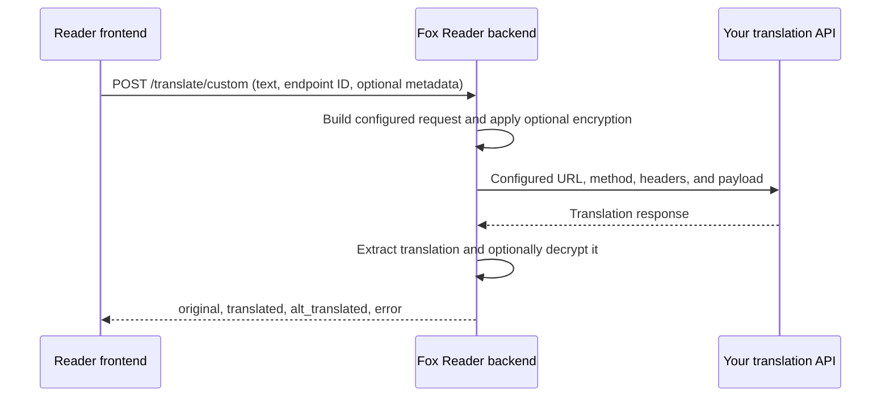

# Custom endpoints

Custom endpoints let Fox Reader use an HTTP translation service that you configure. The service can run on your machine or on another server. You describe the request it expects and the response it returns; Fox Reader adds a translator button for it.

This guide covers the endpoint editor, YAML import/export, conversation context, character and speaker data, encryption, saved-key Show/Hide, and the management API. Example hostnames ending in `.invalid` are placeholders. Replace them with your service's address.

## Contents

- [How a translation travels](#how-a-translation-travels)
- [Quick start: a JSON translation API](#quick-start-a-json-translation-api)
- [Connection, languages, and limits](#connection-languages-and-limits)
- [Request and response formats](#request-and-response-formats)
- [Working with schema trees](#working-with-schema-trees)
- [Context, characters, and the current speaker](#context-characters-and-the-current-speaker)
- [Preview, test, and activate](#preview-test-and-activate)
- [Sharing endpoints with YAML](#sharing-endpoints-with-yaml)
- [Encryption and saved keys](#encryption-and-saved-keys)
- [Changing keys without interrupting translations](#changing-keys-without-interrupting-translations)
- [Examples for other API layouts](#examples-for-other-api-layouts)
- [Implementing encryption on your server](#implementing-encryption-on-your-server)
- [Management API and saved configuration](#management-api-and-saved-configuration)
- [Troubleshooting](#troubleshooting)
- [Implementation references](#implementation-references)

## How a translation travels



There are two separate requests:

1. **Reader to Fox Reader:** uses Fox Reader's internal translation format.
2. **Fox Reader to your API:** uses the format you define in the endpoint editor.

The backend performs the external HTTP request. For a local service, `127.0.0.1` therefore means the machine running the Fox Reader backend.

The configured service does the translation. A custom endpoint does not require Fox Reader's **MTL** switch to be enabled. Its request schema determines which fields reach your service, and your service decides how to use them. Adding a Context field, for example, sends conversation data; the service must implement the logic that uses it.

Useful terms:

| Term | Meaning |
|---|---|
| Endpoint | One saved connection and request/response configuration. |
| Endpoint ID | The internal identifier used to select that configuration. |
| Name | The short label on its translator button. |
| Schema | A tree describing how to build a request or find values in a response. |
| Node | One field, object, array, or array element in that tree. |
| Source | The value a node receives, such as Text or Current Speaker. |
| Wire format | How the built request is transmitted: JSON, form data, query parameters, or text. |
| Character ID / `meta_id` | An identifier joining a speaker reference to a character in the roster. It is unrelated to the endpoint ID. |

## Quick start: a JSON translation API

Suppose your API accepts `POST https://api.example.invalid/v1/translate` with this JSON body:

```json
{
  "q": "こんにちは。",
  "source": "ja",
  "target": "en"
}
```

It returns:

```json
{
  "translation": "Hello.",
  "error": null
}
```

Configure it as follows:

1. Open **Settings → Manage endpoints**, or visit `/user_endpoints` on your Fox Reader server. With the default address, this is `http://127.0.0.1:7954/user_endpoints`.
2. Select **Add Endpoint**.
3. Set **Name** to `MyAPI`, **Method** to `POST`, and **Hostname / path** to `api.example.invalid/v1/translate`, and **Scheme** to `https`.
4. Set **Request body** to `json` and **Response body** to `json`.
5. Under **Supported languages**, select **Japanese** and enter `ja` as its language code. Keep **Target language** as `en`.
6. Keep the request root as `dict`. Add or rename its fields to match this table:

   | Field name | Type | Value source |
   |---|---|---|
   | `q` | `string` | Text |
   | `source` | `string` | Source Language |
   | `target` | `string` | Target Language |

7. Keep the response root as `dict` and configure:

   | Field name | Type | Value source |
   |---|---|---|
   | `translation` | `string` | Translated Text |
   | `error` | `string` | Error |

8. If the API requires an API token, add the header or query parameter specified by its documentation. For example, a header named `Authorization` with value `Bearer YOUR_API_TOKEN`. This token is separate from Fox Reader's optional encryption key.
9. Select **Preview request** and inspect the URL, headers, and body.
10. Select **Save Endpoint**, then use **Send test** on its card. This sends a real request to your API.
11. Activate the endpoint for Japanese using the language control on its card.
12. Return to the reader, select Japanese, and choose the **MyAPI** translator button.

The editor has a default `text` request field and `text` response field. Rename them when your API uses names such as `q` and `translation`. Setting a field's name alone does not make it dynamic: select the correct **value source** too.

### The same schemas in their stored representation

The following blocks describe schema trees, rather than the JSON sent to the translation service. They are useful when working with the management API or inspecting saved configuration. The visual editor builds these structures for you.

Request schema:

```json
{
  "type": "dict",
  "children": {
    "q": {"type": "string", "source": "text"},
    "source": {"type": "string", "source": "src_lang"},
    "target": {"type": "string", "source": "target_lang"}
  }
}
```

Response schema:

```json
{
  "type": "dict",
  "children": {
    "translation": {"type": "string", "source": "text"},
    "error": {"type": "string", "source": "error"}
  }
}
```

The response Error node can receive JSON `null` even when its configured node type is `string`. A missing or null error means there is no API error message to report.

## Connection, languages, and limits

| Editor field | Meaning and accepted values |
|---|---|
| Name | Required button label, at most 6 characters. Unique across all saved endpoints and languages; case and surrounding whitespace are ignored. |
| Method | `GET`, `POST`, `PUT`, `PATCH`, or `DELETE`, according to the API's contract. |
| Hostname / path | Required hostname with optional path, such as `api.example.invalid/v1/translate`. Do not include `http://`, `https://`, another URI scheme, or a leading `//`. |
| Scheme | `https` by default, or `http`. Select the protocol here, separately from the hostname. |
| Port | Optional integer from 1 to 65535. It is inserted before the path. If the URL already includes a port, that port is used. |
| HTTP version | Default uses the client's normal HTTP/1.1 path. HTTP/2 enables HTTP/2 support when the server can negotiate it. |
| Timeout (seconds) | Positive number, default 20, passed to the HTTP client for each attempt. It is not a total budget across all retries. |
| Retries | 0–5 extra attempts; default 0. A value of 2 permits up to 3 attempts. |
| Max text length | 100–10000 characters, default 2000. The backend checks the new plaintext selection before sending it to your API. This is not a token limit or a limit on the entire context/roster payload. |
| Target language | The destination code your API expects, default `en`. It appears where Target Language or `<TARGET_LANG>` is used. |

For a service listening on port 9000 on your machine, set the hostname to `127.0.0.1/translate`, scheme to `http`, and port to `9000`. An inline port, such as `127.0.0.1:9000/translate`, also works.

Existing saved configurations containing a full HTTP(S) URL are migrated when the store loads: its protocol moves to Scheme, preserving the effective URL, endpoint ID, activation, and encryption key. New saves, previews, and YAML imports require a hostname without the protocol prefix.

Fox Reader removes trailing `/` characters when building the configured URL. Inspect the preview if your service distinguishes paths with and without a trailing slash.

### Language names and language codes

Fox Reader's reader uses names such as `japanese`, `chinese`, and `korean`. An external API may require `ja`, `zh`, and `ko`, or another spelling.

| Reader language | Example API code |
|---|---|
| Japanese | `ja` |
| Chinese | `zh` |
| Korean | `ko` |

The language code is optional. Without a mapping, the external Source Language value is the Fox Reader language name, such as `japanese`.

Names are unique even when endpoints support different languages or are inactive. For example, `MyAPI`, `myapi`, and ` MyAPI ` conflict. You can keep an endpoint's own name when editing it. Older saved duplicates remain available with their IDs, settings, keys, and activation unchanged, but an edit must use a unique name before it can be saved. Deleting or renaming an endpoint frees its old name.

A single saved endpoint can support several languages. Activation is separate for each language. Each language can have **20 saved endpoints**, with **3 active at a time**. An endpoint must be active for the reader's selected language to appear as a translator button.

The management API also accepts other language names, but the reader's normal language picker offers Japanese, Chinese, and Korean. Adding a name through the API does not add a new OCR language or reader control.

### Retry behavior

Fox Reader retries transport errors, timeouts, and these HTTP statuses when retries remain:

`408`, `425`, `429`, `500`, `502`, `503`, `504`.

The normal delays before successive retries are 0.4, 0.8, 1.6, 3.2, and 4 seconds. A numeric `Retry-After` value is used when it is greater than zero and no more than 4 seconds. HTTP-date values and larger values use the normal delay instead.

The request is prepared once and reused for retries. A generated request UUID and encrypted values therefore remain the same across attempts for one translation. A successful HTTP response with invalid JSON or a missing translation is reported as an error; response parsing does not initiate another retry.

## Request and response formats

### Request body

| Choice | What the API receives |
|---|---|
| Auto | Query parameters for `GET` and `DELETE`; a JSON body for the other methods. |
| `json` | The schema's result serialized as JSON, with default `Content-Type: application/json`. |
| `form` | URL-encoded form fields in the body, with default `Content-Type: application/x-www-form-urlencoded`. |
| `query` | Schema fields appended to the URL. No request body is sent. |
| `text` | A string is sent directly; a dict/list is still JSON-serialized. The default content type is `text/plain; charset=utf-8`. |

`form` and `query` require a `dict` root and reject a direct `dict` child. Lists are allowed, with the behavior below. JSON is the straightforward choice for nested objects and structured character/context data.

**Choosing `text` does not automatically send only the selected text.** For a service that requires a bare text body, choose **string root** and the **Text** source in the editor. Its schema is `{"type": "string", "source": "text"}`. See [bare text requests](#bare-text-requests).

### Repeat list keys (`doseq`)

This setting applies to `form` and `query`. Suppose a field named `dt` has the value `["t", "at"]`:

| Setting | Decoded meaning | Encoded form/query fragment |
|---|---|---|
| `false` | One value containing compact JSON: `dt=["t","at"]` | `dt=%5B%22t%22%2C%22at%22%5D` |
| `true` | Two values with the same name | `dt=t&dt=at` |

For context or character arrays, your API must understand the selected encoding. These are native arrays when sent as JSON; form/query fields are strings or repeated strings. JSON `null` in a flat scalar field becomes an empty string in form/query encoding.

### Headers and static query parameters

Headers and static query values are strings. Typical headers include `Authorization`, `X-API-Key`, and an API-specific version header. Fox Reader provides a default Content-Type for request bodies; a configured Content-Type header overrides it.

Static query parameters are appended for every request format. With a `query` request body, a schema field takes precedence over a static query parameter with the same name. Use the separate query fields for parameters instead of manually assembling escaped values in the hostname.

### Response body and joining fragments

| Choice or field | Behavior |
|---|---|
| Response body: `json` | Parse JSON and read the values selected by the response schema. |
| Response body: `text` | Treat the whole response body as the translation. Runtime extraction ignores the response tree. |
| Join response chunks with | Separator between extracted translation fragments. Blank means concatenate directly; `\n` and `\t` in the editor represent a newline and tab. |

The saved endpoint model still requires a valid response schema even for `text` responses. Keeping the default response tree satisfies this requirement.

A repeat template handles an array inside a complete JSON response. It does not implement HTTP streaming or server-sent events.

## Working with schema trees

### Field name, type, source, and value

For each field, choose:

1. **Field name:** the exact JSON key required by the API, such as `q`, `source`, or `messages`.
2. **Type:** whether the field is an object, array, string, number, boolean, null, or generated UUID.
3. **Value source:** a dynamic value such as Text, or Static for a configured constant.
4. **Value:** used by static nodes; for a UUID node, this selects the UUID variant.

These are independent. A field named `speaker` with source Current Speaker sends the same speaker ID that a field named `meta_id` with that source would send.

| Node type | Use |
|---|---|
| `dict` | Object with named child fields. |
| `list` | Array with positional items, or a response repeat template. |
| `string` | Text, language codes, static strings, or a Current Speaker source. |
| `int` / `float` | Static numeric values. |
| `bool` | Static `true` or `false`. |
| `null` | Static JSON `null`, or a response Error node. |
| `uuid` | Request-only generated identifier; supports `uuid1`, `uuid2`, and `uuid4`. `uuid4` is the default. |

Use `uuid4` for an ordinary request ID. UUID1 includes time/node information; UUID2 follows the implementation's DCE-style variant. UUIDs identify requests, not characters: a UUID node cannot replace Current Speaker.

### Request sources

| Editor label | Stored `source` | Node type | Result |
|---|---|---|---|
| Static | `static` | Any suitable static type | The configured constant or structure. Static strings support the three substitution tokens below. |
| Text | `text` | `string` | The new text to translate; encrypted first when request encryption is enabled. |
| Source Language | `src_lang` | `string` | The selected language's external API code. |
| Target Language | `target_lang` | `string` | The endpoint's target-language value. |
| Context | `context` | `list` | Earlier source/translation pairs. |
| Character Info | `character_info` | `list` | Character roster. |
| Context Links | `context_character_links` | `list` | One speaker ID or null per sent context pair. |
| Current Speaker | `meta_id` | `string` | Speaker ID for the new Text, or JSON null when unassigned/unknown. |

Request rules:

- Exactly one **Text** node is required. Each other dynamic request source is optional and can appear at most once.
- **Character Info** can be used alone, including without history.
- **Context Links** and **Current Speaker** each require a **Character Info** node.
- Include **Context** to send useful Context Links. Older configurations with links but no Context remain loadable, show a warning, and send an empty links list.
- Context, Character Info, and Context Links consume a complete array. They cannot also contain manually configured items or a repeat template.
- Repeat templates belong to response schemas. Error and Alternatives are response-only sources.

### Static-string substitution tokens

Only these tokens are substituted inside a static string, header value, query value, or configured hostname:

| Token | Replacement |
|---|---|
| `<TEXT>` | New selection, or its encrypted token when request encryption is enabled. |
| `<SOURCE_LANG>` | External source-language code. |
| `<TARGET_LANG>` | Configured destination code. |

For example, the static string `Translate this into <TARGET_LANG>: <TEXT>` incorporates the selected text. You must still have exactly one Text source node somewhere in the request schema; static tokens do not satisfy that validation rule.

Preview markers such as `<CONTEXT>`, `<CHARACTER_INFO>`, `<CONTEXT_LINKS>`, `<CURRENT_SPEAKER>`, and `<UUID4>` illustrate dynamic values. They are **not** substitution tokens. Select the appropriate source or UUID type instead of typing one of these markers into a static field.

The schema editor does not run expressions or arbitrary scripts. It cannot automatically turn context pairs into a different provider's chat-message format or interpolate the roster into a prompt string. Use an API that accepts the provided structures, or perform the transformation in your own adapter service.

### Response sources

| Editor label | Stored `source` | Node type | Behavior |
|---|---|---|---|
| Translated Text | `text` | `string` | Required once in the schema; selects the translation value. |
| Error | `error` | `string` or `null` | Optional API error message. A present nonempty error takes precedence over the translation. |
| Alternatives | `alt` | `string` or `list` | Optional alternative translations. Duplicate alternatives and the main translation are removed. |

Objects and lists route extraction to the marked nodes; unmarked response fields are ignored. A marked text node is read permissively: if the actual value is a list/object, scalar values are flattened before joining. Select the specific text field whenever possible to avoid including unrelated metadata.

Point Error at a message field, not a boolean success/error flag. An actual boolean `false` at an Error node becomes the nonempty string `"false"` and is treated as an error. A missing field, JSON null, or an empty string is suitable for a successful reply.

For an array of unknown length, add a **repeat template** (`each`) describing one element. The Translated Text source appears once in the template, and is applied to every element at runtime. Positional `items` instead describe fixed indices, starting at index zero. If both are configured, the repeat template visits the whole array, including positions described by `items`; avoid selecting the same text twice.

## Context, characters, and the current speaker

These features use the reader's current page entries and character roster. They require the corresponding nodes in the custom endpoint's request schema.

### Enabling them

1. Enable **Characters** in the reader's settings to show its character controls and send character data.
2. Add characters through the reader's Characters controls or import their CSV.
3. Assign a **Speaker** to the relevant page entries.
4. Enable **Context** to send earlier translated entries.
5. Add Character Info, Current Speaker, Context, and Context Links nodes according to what your service needs.

Characters and Context are independent:

| Reader setting | Metadata available to configured schema nodes |
|---|---|
| Context on, Characters on | Earlier pairs, roster, historical speakers, and current speaker. |
| Context on, Characters off | Earlier pairs; empty roster and unknown speaker references. |
| Context off, Characters on | Roster and current speaker; empty history and history links. |
| Both off | Empty metadata arrays and null current speaker. |

The backend emits only fields present in your schema. If a Context node exists but there is no history, its field contains `[]`. Without the node, that field is absent entirely.

### What counts as context

Context is `[[original text, existing translation], ...]`, oldest first. The frontend:

- Uses entries strictly before the selected entry in the current page's reading/list order.
- Includes only visible entries with both original text and translated text.
- Keeps the latest 10 eligible pairs.
- Does not include the current entry or future entries.

The backend normalizes whitespace and caps each side of a pair at 1000 characters. Filtering or trimming pairs also filters their speaker links at the same positions.

The first entry naturally has no history. Plain text entered without a selected page entry has no page context or speaker assignment. History uses the translations already stored on entries; with the usual English workflow, the second item is English. A custom target-language setting does not retranslate previous entries into that language.

### Character fields

| Field | Meaning |
|---|---|
| `meta_id` | Generated character ID. References must match this ID, not the character's name. |
| `name_en` | English name, or null. |
| `name_ja` | Japanese name, or null. This is the actual field name even when a custom endpoint serves another language. |
| `gender` | `male`, `female`, or null. |
| `alias_en` | English alias as a string, or null. |
| `alias_ja` | Japanese alias as a string, or null. |

Aliases are strings, not arrays. The roster is capped at 50 characters, and name/alias fields at 100 characters. Unsupported fields are not carried through as arbitrary character attributes. Malformed rows are dropped; duplicate IDs keep the first usable entry. Unknown historical or current speaker IDs become null.

CSV uses the header below; Fox Reader assigns IDs on import:

```csv
name_en,name_ja,gender,alias_en,alias_ja
Aiko,愛子,female,Ai-chan,愛ちゃん
Ken,健,male,,
```

The character roster is held in memory and cleared when changing the source folder. Export a CSV if you need to restore it after restarting. Reimporting creates new IDs, so reassign speakers as needed.

### Complete example with two speakers

Use this request schema for an API that accepts the field names shown:

```json
{
  "type": "dict",
  "children": {
    "text": {"type": "string", "source": "text"},
    "source": {"type": "string", "source": "src_lang"},
    "target": {"type": "string", "source": "target_lang"},
    "context": {"type": "list", "source": "context"},
    "character_info": {"type": "list", "source": "character_info"},
    "context_character_links": {"type": "list", "source": "context_character_links"},
    "meta_id": {"type": "string", "source": "meta_id"}
  }
}
```

With Japanese mapped to `ja`, the external API could receive this JSON body:

```json
{
  "text": "じゃあ、私も一緒に行く。",
  "source": "ja",
  "target": "en",
  "context": [
    ["健、どこへ行くの？", "Ken, where are you going?"],
    ["駅に行くんだ。", "I'm going to the station."]
  ],
  "character_info": [
    {
      "meta_id": "a1b2c3d4",
      "name_en": "Aiko",
      "name_ja": "愛子",
      "gender": "female",
      "alias_en": "Ai-chan",
      "alias_ja": "愛ちゃん"
    },
    {
      "meta_id": "e5f6a7b8",
      "name_en": "Ken",
      "name_ja": "健",
      "gender": "male",
      "alias_en": null,
      "alias_ja": null
    }
  ],
  "context_character_links": ["a1b2c3d4", "e5f6a7b8"],
  "meta_id": "a1b2c3d4"
}
```

The IDs are examples; use the IDs generated for your roster.

| Reference | Speaker |
|---|---|
| `context_character_links[0]` | Aiko spoke the first context pair. |
| `context_character_links[1]` | Ken spoke the second context pair. |
| Top-level `meta_id` | Aiko speaks the new `text`. |

The last historical speaker does not determine the current speaker. The top-level Current Speaker field is what identifies the new line's speaker.

To send only names and the current speaker without history, keep Text, Character Info, and Current Speaker in the schema. Context and Context Links are unnecessary for that use case.

## Preview, test, and activate

### Preview request

**Preview request** validates the draft and builds the request without contacting the external API. It shows the resolved method, URL, headers, body format, and body.

When no metadata is supplied to the preview API, configured metadata fields receive a coherent sample: two earlier pairs, one character, historical links, and a current speaker. This demonstrates the shape; it is not the reader's current page data.

If any metadata field is explicitly supplied through the preview/test API, omitted companion fields default to empty arrays or null. Explicit nulls and empty arrays stay empty. Actual input is never combined with unrelated sample speakers.

Preview creates fresh UUIDs and encrypted tokens when those features are configured. A later translation creates its own request values.

### Send test

**Send test** uses the saved configuration and contacts the external service. The UI sends sample text (`こんにちは`) and the same representative metadata bundle for configured fields. It shows the result and **the actual prepared request used for that test**, including its UUID and encrypted tokens.

You can supply your own text, language, and metadata using the test API. Test requests do not require the endpoint to be active. An unsaved change is available to Preview, but Send test uses the version already saved.

Testing also works before local model setup is complete: the saved endpoint uses the HTTP translator directly. An invalid URL, connection failure, timeout, or unusable response appears as a failed test with a status code and explanation. The server logs a concise failure summary; the result dialog contains the detailed response and prepared request.

Page messages and test results appear in a dialog that stays visible when the page is scrolled. Use **Close**, press Escape, or click outside the box to dismiss it. Dismissing test progress does not cancel the request; the result appears when it finishes. Send test buttons are disabled while a test is running.

A successful test checks the configured request, response extraction, and optional encryption. To verify actual page context and assigned speakers, also translate a selected entry in the reader.

### Activation and automatic translation

Saving does not activate an endpoint. Use the language controls on its saved card, then choose that translator in the reader. The reader's Auto TL feature follows the selected translator; the existing Context and Characters switches also apply to custom translations. Page translation uses the same metadata builders as individual entries.

## Sharing endpoints with YAML

Export shares **one endpoint at a time**. On its card, select **Export YAML**, review the text in the overlay, then select **Copy YAML**. If automatic clipboard access is unavailable, the overlay selects the text so you can copy it with Ctrl+C or Cmd+C.

To import:

1. Select **Import YAML** and paste one endpoint document.
2. Select **Validate and review**. Invalid YAML stays in the overlay with an explanation, a line/column where available, and a suggested correction. Edit the text and try again; Fox Reader does not silently repair it.
3. Review the editable draft. If its name is already used, a warning asks you to choose a different name before saving. If encryption is enabled, enter your own matching shared key. Imported drafts never reuse a saved endpoint's key.
4. Select **Save Endpoint** to create a new endpoint with a new ID. Activate it separately for the desired language. Closing the draft leaves your saved endpoints unchanged.

The portable format uses `version: 1` and one `endpoint` mapping. This complete minimal example can be pasted directly:

```yaml
version: 1
endpoint:
  name: MyAPI
  hostname: api.example.invalid/v1/translate
  host_scheme: https
  method: POST
  body_format: json
  response_format: json
  languages: [japanese]
  language_codes:
    japanese: ja
  target_language: en
  request_schema:
    type: dict
    children:
      q: {type: string, source: text}
      source: {type: string, source: src_lang}
      target: {type: string, source: target_lang}
  response_schema:
    type: dict
    children:
      translation: {type: string, source: text}
      error: {type: string, source: error}
  encryption:
    enabled: false
```

Exports include connection options, language mappings, request/response schemas (including context and character sources), and encryption settings. They omit the endpoint ID, activation state, `encryption.key`, and key-presence flags. Pasting those nonportable fields is rejected. Encryption options such as enabled directions and key encoding are preserved, but a matching key must be entered before an encrypted draft can be saved or previewed.

**Review the YAML before sharing it.** Authentication headers, query parameters, and static schema values remain in the export; these can contain API tokens or other credentials. Only the dedicated shared encryption key is automatically excluded.

Import uses the same connection, language, encryption-option, and schema validation as the normal editor. Saved-endpoint and activation limits still apply when saving or activating. A draft can be reviewed when a language's endpoint limit is reached, with a warning; saving remains blocked until the limit is resolved.

A document is limited to **128 KiB of UTF-8 text**, 32 nested levels, and 8,192 YAML nodes. Only one document is accepted. Duplicate keys, aliases, custom tags, non-string mapping keys, unknown settings, and non-finite numbers are rejected. Quote values such as dates or `yes` when they should be strings. Export applies the same size and structure limits, so a successfully exported document fits the import parser.

The management import route accepts only `{"yaml": "..."}` (JSON body limit: 256 KiB). Success returns `{"endpoint": {...}, "requires_key": true/false, "warnings": [...]}`; the draft has no ID or key. Validation failures return HTTP 400 with `{"error": "...", "suggestions": [...]}`. Both import and export responses use `Cache-Control: no-store`. Neither operation sends a translation request or modifies the endpoint store.

The reader, `/setup`, `/settings`, and `/user_endpoints` share backend health monitoring. An offline overlay offers **Retry** and clears when the same backend recovers. If the backend restarts, **Refresh** explicitly reloads the page; this discards unsaved drafts. Fox Reader never automatically refreshes a form after a restart. The notice stays above open editor or transfer dialogs.

## Encryption and saved keys

Encryption is optional and requires the `cryptography` package. Your service must implement the matching encryption contract before you enable it.

An API token authenticates access to a service. An encryption key transforms translation text into a Fernet token. They serve different purposes and may both be needed.

### Controls and terminology

| Control or term | Meaning |
|---|---|
| Encryption | Enables the endpoint's encryption settings. At least one direction must be enabled. |
| Key type: `fernet` | A 44-character, URL-safe Base64 key representing 32 bytes, as returned by `Fernet.generate_key()`. |
| Key type: `passphrase` | Shared words from which both sides derive a Fernet key using the parameters below. |
| Shared key | One key or a rotation list of up to four. |
| Generate | Creates a random Fernet key in the browser and displays it. Configure the same value on the server, then save. |
| Show / Hide | Reveals or masks the field; Show can retrieve a saved key after reopening the endpoint. |
| Text sent | Encrypt the outgoing selection and supported metadata fields. |
| Reply | Decrypt the returned translation and alternatives. |
| Reject replies older than | Optional maximum Fernet token age, 30–86400 seconds. Blank disables the age check. |
| Seal / encrypt | Turn plaintext into an authenticated Fernet token. |
| Open / decrypt | Validate a token and recover its plaintext using an accepted key. |

Fernet provides authenticated encryption using AES-128-CBC and HMAC-SHA256. The service with the shared key can read the text so it can translate it. Field names, language codes, speaker IDs, gender, request timing, and approximate sizes remain visible in the outer request.

### What is encrypted

When **Text sent** is enabled:

| Value | Treatment |
|---|---|
| New Text | Encrypted once before building the request. |
| `<TEXT>` substitutions | Use that encrypted Text value, including in headers, query values, or the URL. |
| Each source and translation in Context | Encrypted separately; the array-of-pairs structure stays intact. |
| Character `name_en`, `name_ja`, `alias_en`, `alias_ja` | Each non-null field is encrypted separately. |
| Character IDs, Context Links, Current Speaker | Remain plain IDs so their relationships are preserved. |
| Character gender | Remains plaintext. |
| Language codes, UUIDs, other static fields | Remain plaintext. |

Only metadata consumed by configured schema nodes is processed. The entire JSON document is not encrypted as one blob.

When **Reply** is enabled, your API must return a Fernet token for every translation fragment and alternative selected by the response schema. Fox Reader decrypts fragments individually before joining them. An invalid main translation token fails the translation; an invalid alternative is dropped. Error messages are not decrypted by this option.

The token-age setting checks the token's timestamp, so both systems need reasonably aligned clocks. It is an age check, not a database that prevents a token being replayed within the allowed interval.

### Revealing and replacing a saved key

1. Save the endpoint with encryption enabled and a valid key.
2. Reopen its editor. The key input starts blank and hidden, and the hint says a key is stored.
3. Select **Show**. Fox Reader retrieves the saved key and its key type on demand.
4. Select **Hide** to mask it. Further Show/Hide clicks reuse that loaded value while the editor remains open.

Closing the editor, including with Escape, clears the displayed value. Pending requests are cancelled or ignored if you close the editor, open another endpoint, or edit/generate a replacement key.

Leaving the input blank, or leaving a revealed key unchanged, preserves the backend's current **key and key type together**. To change the key type, reveal or enter a key and explicitly choose the new type. Merely viewing a key does not count as replacing it.

Saving with encryption disabled clears the stored encryption key. The key-reveal response is marked `Cache-Control: no-store`; ordinary endpoint list/save responses include `has_key` rather than the key itself. Keys are still stored in the local endpoint configuration file, so a copy of that configuration contains the saved secrets.

## Changing keys without interrupting translations

One key is enough for ordinary use. Multiple keys allow a gradual replacement:

- The **first key encrypts** outgoing text.
- **Any listed key can decrypt** incoming text.
- All keys in one list use the selected key type.
- Fernet keys are separated by spaces or commas. In the editor, separate passphrases with commas; spaces inside a passphrase are part of it. API-supplied passphrase lists also accept newlines as separators.

In the following example, `OLD` and `NEW` stand for real keys, not literal values to paste:

| Stage | Fox Reader | Translation server | Effect |
|---|---|---|---|
| Initial | `OLD` | `OLD` | Both use the old key. |
| Prepare both sides | `OLD, NEW` | `OLD, NEW` | Both still encrypt with OLD and can accept NEW. |
| Switch Fox Reader | `NEW, OLD` | `OLD, NEW` | Requests use NEW; server replies may still use OLD. Both can decrypt. |
| Switch the server | `NEW, OLD` | `NEW, OLD` | Both encrypt using NEW and still accept OLD. |
| Finish | `NEW` | `NEW` | Remove OLD after in-flight old messages and relevant retry windows are finished. |

During preparation, you can update the sides one at a time because OLD remains first. Do not make NEW the first encryption key on either side until the other side can decrypt it.

“Without a flag day” means there is no requirement for both sides to switch their active encryption key at exactly the same moment. Your translation server must support the same multiple-key decryption behavior. Python's `MultiFernet` provides it for Fernet keys.

## Examples for other API layouts

### GET query or POST form API

Suppose the API expects `q`, `sl`, `tl`, and repeated `dt` values. Configure this request schema:

```json
{
  "type": "dict",
  "children": {
    "q": {"type": "string", "source": "text"},
    "sl": {"type": "string", "source": "src_lang"},
    "tl": {"type": "string", "source": "target_lang"},
    "dt": {
      "type": "list",
      "items": [
        {"type": "string", "value": "t"},
        {"type": "string", "value": "at"}
      ]
    }
  }
}
```

For **Method GET**, **Request body query**, **doseq true**, a selection `Hello world` with codes `en` and `ja` produces:

```text
https://api.example.invalid/translate?q=Hello+world&sl=en&tl=ja&dt=t&dt=at
```

For **Method POST** and **Request body form**, those encoded fields go in the request body instead. Choose the response schema separately to match the service's actual reply.

### A nested chat-style API

An API might expect a model name and one user message. Its request schema can be:

```json
{
  "type": "dict",
  "children": {
    "model": {"type": "string", "value": "your-model-id"},
    "messages": {
      "type": "list",
      "items": [
        {
          "type": "dict",
          "children": {
            "role": {"type": "string", "value": "user"},
            "content": {"type": "string", "source": "text"}
          }
        }
      ]
    },
    "stream": {"type": "bool", "value": false}
  }
}
```

If the response contains `choices[0].message.content`, use a fixed first list item:

```json
{
  "type": "dict",
  "children": {
    "choices": {
      "type": "list",
      "items": [
        {
          "type": "dict",
          "children": {
            "message": {
              "type": "dict",
              "children": {
                "content": {"type": "string", "source": "text"}
              }
            }
          }
        }
      ]
    }
  }
}
```

This is an example layout, not a universal API preset. Configure the model, authentication, and translation instructions required by your service. A static system message can hold instructions, while the user message contains the Text node. The schema does not automatically convert Fox Reader's context pairs into additional chat messages.

### Multiple translated fragments and alternatives

Suppose the response is:

```json
{
  "data": {
    "sentences": [{"translation": "Hello."}, {"translation": "How are you?"}],
    "candidates": ["Hi. How are you?", "Hi. How are you?"]
  },
  "error": null
}
```

Configure this response schema:

```json
{
  "type": "dict",
  "children": {
    "data": {
      "type": "dict",
      "children": {
        "sentences": {
          "type": "list",
          "each": {
            "type": "dict",
            "children": {
              "translation": {"type": "string", "source": "text"}
            }
          }
        },
        "candidates": {"type": "list", "source": "alt"}
      }
    },
    "error": {"type": "string", "source": "error"}
  }
}
```

Set **Join response chunks with** to `\n` to obtain:

```text
Hello.
How are you?
```

Only one copy of the duplicate alternative is retained. If the response is instead a top-level array, use a list root with the appropriate fixed items or repeat template.

### Bare text requests

For an API expecting the selected text as its whole request body, select request body `text`, response body `text`, and string roots with the Text source. The equivalent management API configuration is:

```json
{
  "id": "plain-demo",
  "name": "Plain",
  "hostname": "api.example.invalid/translate",
  "host_scheme": "https",
  "method": "POST",
  "languages": ["japanese"],
  "body_format": "text",
  "response_format": "text",
  "request_schema": {"type": "string", "source": "text"},
  "response_schema": {"type": "string", "source": "text"}
}
```

The body is the selection itself, without JSON quotes. String roots can also be imported and reviewed in the visual editor.

## Implementing encryption on your server

The following Python helpers illustrate the encryption contract. They do not implement an HTTP server or translation model. Use them inside your service's request/response handling, with the same key list configured in Fox Reader.

### Fernet keys and field handling

Generate a key using **Generate** in the editor, or with `Fernet.generate_key().decode("ascii")`. Keep the generated value as the shared secret. This helper reads a space/comma-separated Fernet key list from an environment variable named `FOX_ENDPOINT_KEYS`:

```python
import copy
import os
import re

from cryptography.fernet import Fernet, MultiFernet

keys = [part for part in re.split(r"[\s,]+", os.environ["FOX_ENDPOINT_KEYS"].strip()) if part]
if not 1 <= len(keys) <= 4:
    raise ValueError("Configure one to four Fernet keys")
cipher = MultiFernet([Fernet(key.encode("ascii")) for key in keys])


def decrypt_text(token):
    return cipher.decrypt(token.encode("ascii")).decode("utf-8")


def encrypt_text(text):
    return cipher.encrypt(text.encode("utf-8")).decode("ascii")


def open_request(payload):
    """For the text/context/character_info field names used in this guide."""
    opened = copy.deepcopy(payload)
    opened["text"] = decrypt_text(opened["text"])
    opened["context"] = [
        [decrypt_text(source), decrypt_text(translation)]
        for source, translation in opened.get("context", [])
    ]
    for character in opened.get("character_info", []):
        for field in ("name_en", "name_ja", "alias_en", "alias_ja"):
            if character.get(field) is not None:
                character[field] = decrypt_text(character[field])
    return opened


def seal_response(translation, alternatives=()):
    return {
        "translation": encrypt_text(translation),
        "alternatives": [encrypt_text(text) for text in alternatives],
        "error": None,
    }
```

Use `open_request` when Fox Reader's **Text sent** encryption is on, and `seal_response` when **Reply** decryption is on. Adapt field names to your schema. For `seal_response`, mark `translation` as Translated Text and `alternatives` as Alternatives in Fox Reader's response schema.

The helper leaves IDs, links, gender, and other unencrypted fields unchanged. Your translation code can use the decrypted names and dialogue together with those IDs.

### Passphrase compatibility

Passphrase mode derives a Fernet key from each comma- or newline-separated phrase using:

| Parameter | Value |
|---|---|
| Input | UTF-8 bytes of the trimmed phrase |
| Algorithm | scrypt |
| Salt | UTF-8 bytes of `fox-reader/user-endpoint/v1` |
| N | 16384 |
| r | 8 |
| p | 1 |
| Output length | 32 bytes |
| scrypt memory limit | 64 MiB (`maxmem=64 * 1024 * 1024`) |
| Fernet key encoding | URL-safe Base64 of those 32 bytes |

Equivalent Python:

```python
import base64
import hashlib
import re

from cryptography.fernet import Fernet, MultiFernet


def passphrase_cipher(secret):
    phrases = [phrase.strip() for phrase in re.split(r"[\r\n,]+", secret) if phrase.strip()]
    if not 1 <= len(phrases) <= 4:
        raise ValueError("Configure one to four comma- or newline-separated passphrases")
    keys = [
        base64.urlsafe_b64encode(hashlib.scrypt(
            phrase.encode("utf-8"),
            salt=b"fox-reader/user-endpoint/v1",
            n=16384,
            r=8,
            p=1,
            dklen=32,
            maxmem=64 * 1024 * 1024,
        ))
        for phrase in phrases
    ]
    return MultiFernet([Fernet(key) for key in keys])
```

Initialize the cipher when loading the configuration and reuse it. Passphrase derivation is more expensive than encrypting individual strings. All server instances handling the endpoint must accept the keys used by Fox Reader.

## Management API and saved configuration

These routes belong to the **Fox Reader server**, not your external translation service:

| Method and route | Purpose |
|---|---|
| `GET /user_endpoints` | Open the editor page. |
| `GET /api/user_endpoints` | List saved endpoints, counts, activation, and limits. Routine responses omit encryption keys. |
| `POST /api/user_endpoints/import` | Validate `{"yaml": "..."}` and return an unsaved draft; no endpoint is created or activated. |
| `GET /api/user_endpoints/{id}/export` | Return `{"yaml": "..."}` for one endpoint, excluding its ID, activation, and shared encryption key. |
| `POST /api/user_endpoints` | Create an endpoint from a full configuration object. |
| `PUT /api/user_endpoints/{id}` | Update an endpoint using a full configuration object. This is not a partial PATCH operation. |
| `DELETE /api/user_endpoints/{id}` | Delete an endpoint. |
| `GET /api/user_endpoints/active` | List active translator buttons by language. |
| `PUT /api/user_endpoints/{id}/active` | Activate with a body such as `{"language":"japanese"}`. |
| `DELETE /api/user_endpoints/{id}/active` | Deactivate for the language named in the JSON body. |
| `POST /api/user_endpoints/preview` | Validate/build a draft without sending it externally. |
| `POST /api/user_endpoints/{id}/test` | Send a real test using the saved endpoint. |
| `GET /api/user_endpoints/{id}/key` | Reveal the saved key and `key_encoding` on demand; response is not cacheable. |
| `POST /translate/custom` | Translate reader text through the selected custom endpoint. |

API-created configurations need a stable nonempty `id`. The editor generates one for new endpoints. Use a distinct ID per configuration; the short Name is only the button label.

### Complete configuration example

Send this object to `POST /api/user_endpoints`, replacing the hostname with your own service:

```json
{
  "id": "demo-json",
  "name": "MyAPI",
  "hostname": "api.example.invalid/v1/translate",
  "host_scheme": "https",
  "method": "POST",
  "body_format": "json",
  "response_format": "json",
  "languages": ["japanese"],
  "language_codes": {"japanese": "ja"},
  "target_language": "en",
  "timeout": 20,
  "retries": 0,
  "max_text_length": 2000,
  "request_schema": {
    "type": "dict",
    "children": {
      "q": {"type": "string", "source": "text"},
      "source": {"type": "string", "source": "src_lang"},
      "target": {"type": "string", "source": "target_lang"}
    }
  },
  "response_schema": {
    "type": "dict",
    "children": {
      "translation": {"type": "string", "source": "text"},
      "error": {"type": "string", "source": "error"}
    }
  },
  "encryption": {"enabled": false}
}
```

For a draft preview, wrap the configuration under `endpoint`, and optionally add `text`, `language`, `context`, `character_info`, `context_character_links`, and `meta_id` beside it. `language` uses a Fox Reader language name such as `japanese`; the endpoint's language mapping supplies `ja` externally.

For a saved test without history:

```json
{
  "text": "こんにちは。",
  "language": "japanese",
  "context": [],
  "character_info": [],
  "context_character_links": [],
  "meta_id": null
}
```

Send that body to `POST /api/user_endpoints/demo-json/test`. Sending `{}` instead uses the sample text and metadata bundle.

### The reader's internal translation request

The reader selects the endpoint by sending its ID in `source_lang`. The actual reader language travels as `lang_group`:

```json
{
  "text": "じゃあ、私も一緒に行く。",
  "source_lang": "demo-json",
  "lang_group": "japanese",
  "context": [["駅に行くんだ。", "I'm going to the station."]],
  "character_info": [
    {"meta_id": "a1b2c3d4", "name_en": "Aiko", "gender": "female"},
    {"meta_id": "e5f6a7b8", "name_en": "Ken", "gender": "male"}
  ],
  "context_character_links": ["e5f6a7b8"],
  "meta_id": "a1b2c3d4"
}
```

That body goes to `POST /translate/custom`. It is not automatically forwarded as-is. The `demo-json` example has no metadata nodes, so its external request contains only `q`, `source`, and `target`. Add the metadata nodes shown earlier to send those additional values.

The service also accepts a language name as a selector and then chooses the first active endpoint for that language. Always supply a supported `lang_group`: if it is missing or unsupported, the request uses the selected endpoint's first configured language. For explicit programmatic selection, use an endpoint ID and a supported `lang_group`.

A successful reader response looks like:

```json
{
  "original": "じゃあ、私も一緒に行く。",
  "translated": "Then I'll go with you.",
  "alt_translated": "",
  "error": null
}
```

Custom translation failures are normally represented by `error` in this JSON response, even when the Fox Reader HTTP response is 200. The test route similarly reports `status`, `code`, and `message`. Check those fields as well as HTTP status; malformed incoming requests can still receive framework validation errors such as HTTP 422.

### Storage

Saved endpoint configurations and per-language activation are stored in `config/user_endpoints.yaml` under the Fox Reader data root. This includes headers, static query values, and encryption keys. Use the editor or management API for changes while Fox Reader is running; editing the file alone does not reload the in-memory store.

The endpoint configuration persists across restarts. Page context and the in-memory character roster have separate lifecycles; they are not embedded in each endpoint's saved configuration.

## Troubleshooting

| Symptom | What to check |
|---|---|
| Name already exists | Choose a unique name (ignoring case and surrounding whitespace), including for imported drafts. Names are shared across all languages. Existing duplicates must be renamed before saving edits. |
| No translator button | Save the endpoint, activate it for the selected reader language, and check the limit of 3 active endpoints per language. |
| Wrong URL or language code | Inspect Preview request; check the Scheme selector, port, hostname/path, selected supported language, and its code mapping. |
| “Exactly one Text node” | Assign Text as a dynamic source to one string node. A static `<TEXT>` token alone does not count. |
| A literal `<CURRENT_SPEAKER>` or `<CONTEXT>` reaches the API | Use Current Speaker or Context as a node's source; these preview labels are not static-string substitution tokens. |
| Current speaker is null | Enable Characters, select a page entry, assign its Speaker, and include both Character Info and Current Speaker in the request schema. Check that its ID exists in the roster. |
| Context is empty | Enable Context; select an entry with earlier visible entries that contain both original and translated text on the same page. |
| Context Links is empty | Include a Context node and ensure eligible history exists. Without Context, links are suppressed even in older saved schemas. |
| Context links contain nulls | Assign speakers to those earlier entries and enable Characters. Unknown or deleted IDs become null. |
| Expected a raw text body but got JSON | Request body `text` still serializes a dict/list root as JSON. Choose a string root with the Text source. |
| API returns 401/403 | Check its authentication header or query parameter. A Fox Reader encryption key does not replace an API authentication token. |
| Test works, page translation fails | Compare text length, actual context/roster size, field values, and speaker assignments; the test UI uses representative samples. |
| Saved-key field is blank after reopening | This is the initial state. Select Show to load the saved key, or leave it blank to keep the stored key and type. |
| Show cannot retrieve a key | Confirm the endpoint still exists and encryption has not been saved as disabled; retry if the backend connection failed. |
| Encryption cannot be enabled | Check `cryptography` availability, valid key material, and at least one enabled direction. |
| Decryption fails | Check the matching key list and key type, passphrase derivation parameters, whether the service encrypts the configured translation fields, and optional token age/clock alignment. |
| Translation includes unrelated values | Select the precise response text field instead of marking a container that also includes metadata. |
| Translation fragments run together | Set Join response chunks with to a space or `\n`, as appropriate. |

Common translation result codes:

| Code | Meaning in the custom translator |
|---|---|
| 400 | No usable text, or an invalid HTTP request configuration such as a malformed URL or header. The reader route also has its own empty-text error response. |
| 404 | No matching endpoint/active language selection, or a remote not-found response. |
| 413 | The new plaintext selection exceeds Max text length. |
| 500 | The request could not be built, or a remote server error. |
| 502 | Invalid JSON, missing/empty translation, decryption failure, or a remote bad-gateway response. |
| 503 | Endpoint service is unavailable or a transport error prevented a response. |
| 504 | Timeout after the configured attempts. |
| Other non-success HTTP codes | The external API's error status, with its extracted error or a response snippet when available. |

Configuration, activation, and key-reveal routes have their own HTTP error responses. In particular, key reveal returns 404 for a missing endpoint or absent key, and 503 when the endpoint store is unavailable.

## Implementation references

These files define the behavior described above:

- [Endpoint editor](../frontend/templates/user_endpoints.html)
- [Endpoint model, validation, and storage](../src/fox_reader/user_endpoints.py)
- [YAML transfer validation](../src/fox_reader/endpoint_transfer.py)
- [YAML transfer regression tests](../tests/test_endpoint_transfer.py)
- [Schema building and response extraction](../src/fox_reader/endpoint_schema.py)
- [External request preparation and execution](../src/fox_reader/translate/custom_endpoint.py)
- [Management, preview, test, and key-reveal routes](../src/fox_reader/routes/user_endpoints.py)
- [Reader translation route](../src/fox_reader/routes/translate.py)
- [Frontend context and speaker collection](../frontend/src/translationContext.ts)
- [Encryption implementation](../src/fox_reader/endpoint_crypto.py)
- [Context/character integration tests](../tests/test_custom_endpoint_context.py)
- [Saved-key regression tests](../tests/test_user_endpoint_keys.py)
